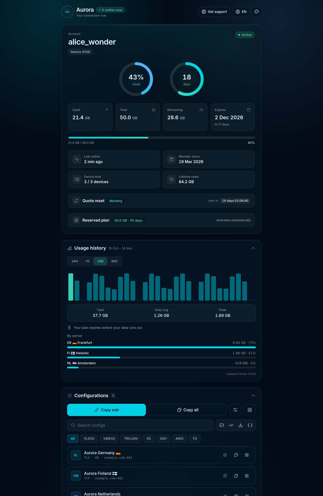
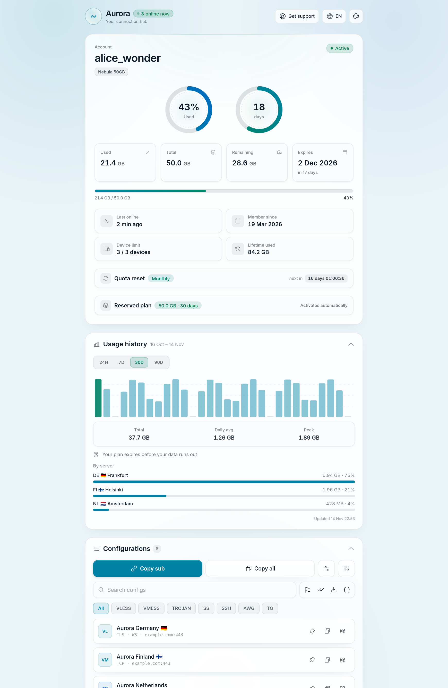

# 🌌 Aurora

**A premium, single-file subscription page template for the [Rebecca panel](https://github.com/rebeccapanel/Rebecca) (`dev` branch).**

Glassmorphism · usage dashboard · EN/FA RTL · white-label · Tailwind v4 + DaisyUI v5 + vanilla JS

---

## 📸 Preview

| Aurora Dark (`auroradark`) | Aurora Light (`auroralight`) |
| :---: | :---: |
|  |  |

*Aurora v4.1.1 (`auroradark` & `auroralight`) — refined boreal glass surfaces, dual usage/time rings, flat SVG chart bars, calm hierarchy, and crisp LTR/RTL typography.*

---

## ✨ Features

- **Aurora v4.1 Visual System & Mobile Layout** — balanced 4-theme chromatic hierarchy (`auroradark` midnight cyan/cobalt, `amoleddark` pure `#000000` OLED contrast with cool ice-slate accents, `auroralight` crisp alabaster glass, and authentic Polar Night slate `nord`), calm `.sub-tile` elevation, 2-column mobile grid for compact metadata (`Last online` / `Member since`, `Device limit` / `Lifetime used`), wrapping VPN protocol tabs, balanced 1-row mobile bulk-action bar, and crisp RTL typography (`Arad` 400/500/600/700 + `tabular-nums`).

- **Live Service Card** — usage/time rings, animated stats, live quota-reset countdown, and 5-minute background `/info` sync. Handles unlimited, never-expire, `on_hold` (showing exact pre-activation duration & *"Starts on first connect"*), reserved/queued `next_plans` badge, device limit (`ip_limit`), lifetime traffic, client-derived expired/limited states, and smart low-traffic / low-time renewal alerts.
- **Support & Renewal** — top-bar quick support button with warning border highlight (`alert-active`) when subscription expiration is near or traffic is running low (automatically suppressed if a reserved plan is already queued).
- **Usage Dashboard 2.0** — `24H` (hourly), `7D`, `30D`, and true `90D` history charts (`?start=`), period summary pill (Total, Daily Avg, Peak), threshold alerts, per-server breakdown, depletion forecast, offline cache, and 5-min auto-refresh.
- **Smart Configs 2.0** — search (remarks, protocols, transports, SNI, host), protocol filters (VMess, VLESS, Trojan, Shadowsocks, Hysteria2, TUIC, SSH, WireGuard, AmneziaWG, MTProto), pin/favorite configs, clean metadata summary subline (`Reality · TCP · server:port`), click-to-inspect **Connection Details Modal** with per-field copy, localized group-by-country (`Intl.DisplayNames`), bulk select + copy, `.txt`/`.json` export, direct `.conf` download for WireGuard and AmneziaWG (with full obfuscation params), and multi-format subscription popover (`Clash Meta`, `Sing-box`, `V2Ray JSON`, `OpenWrt PassWall`, `WireGuard`).
- **VPN & Remote Access Files** (OpenVPN · WireGuard · AmneziaWG · SSTP · GRE · L2TP/IPsec · PPTP · IKEv2 · Cisco AnyConnect) — download/copy `.ovpn` and `.conf` profiles, masked credential cards with MTU/TTL/DNS, one-click Linux (`ip tunnel`) & MikroTik RouterOS (`/interface gre`) CLI commands for GRE, and Windows `.pbk` (phonebook) generation for PPTP, L2TP, IKEv2, and SSTP.
- **Apps** — OS-grouped client catalogue with one-tap deep-link import (from `src/apps.json`), including OpenVPN Connect, OpenVPN GUI, NetMod, WireGuard, Hiddify, Happ, v2rayNG, Streisand, Karing, and more.
- **Themes, i18n & White-Label** — 4 themes (`auroradark`, `amoleddark`, `auroralight`, `nord`), EN/FA/RU/ZH with full RTL, custom brand name, optional header logo (`logo`), and dismissible announcement banner (`announcement`) configurable via `install.sh` without rebuilding.
- **PWA-ready & Resilient** — single self-contained `index.html`, zero external requests at runtime, offline cache, error boundaries, ARIA support.

---

## 🚀 Installation on Rebecca

### Option 1: Interactive Automatic Installer (Recommended)

Run the one-line installer on your Rebecca server to install, customize brand information, and reload the service automatically:

```bash
curl -fsSL https://raw.githubusercontent.com/Ho3einK84/Aurora/main/install.sh | sudo bash
```

### Option 2: Manual Download

In **Master Settings → Subscriptions**, drop the latest build at
`/var/lib/rebecca/templates/subscription/index.html`:

```bash
wget -O /var/lib/rebecca/templates/subscription/index.html \
  https://github.com/Ho3einK84/Aurora/releases/latest/download/index.html
```

---

## 📡 Shared Hosting Proxy

Extract `hosting.zip` from the latest release to your web root, and set your panel URL in `config.php`:

```php
'panel_url' => 'https://panel.example.com:8443',
```

---

## 🎨 Customization

- **White-label, Default Theme & Language (No Rebuild Needed)**:
  Edit `window.AURORA_BRAND` JSON literal or `<meta>` tags in `dist/index.html`:
  ```html
  <meta name="aurora-default-theme" content="amoleddark" />
  <meta name="aurora-default-lang" content="fa" />
  <script>window.AURORA_BRAND = {"name":"MyVPN","supportUrl":"https://t.me/MySupport","defaultTheme":"amoleddark","defaultLang":"fa","logo":"","announcement":""};</script>
  ```
  Or run:
  ```bash
  sudo bash install.sh --brand "MyVPN" --support "https://t.me/MySupport" --lang fa --theme amoleddark --restart
  ```
- **Apps**: Edit `window.AURORA_APPS` in `dist/index.html` or `src/apps.json`.

---

## 🛠 Development

```bash
npm ci
npm run build      # → dist/index.html
npm run serve      # preview at http://localhost:8787
npm run guard      # re-verify directive guard
```

---

## 📄 License

MIT
