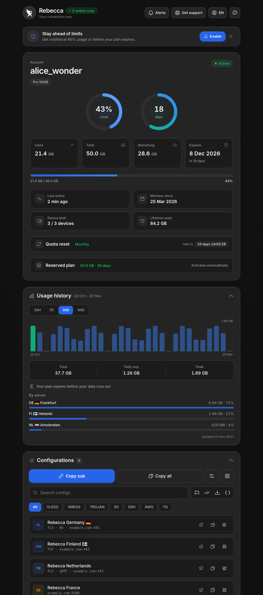
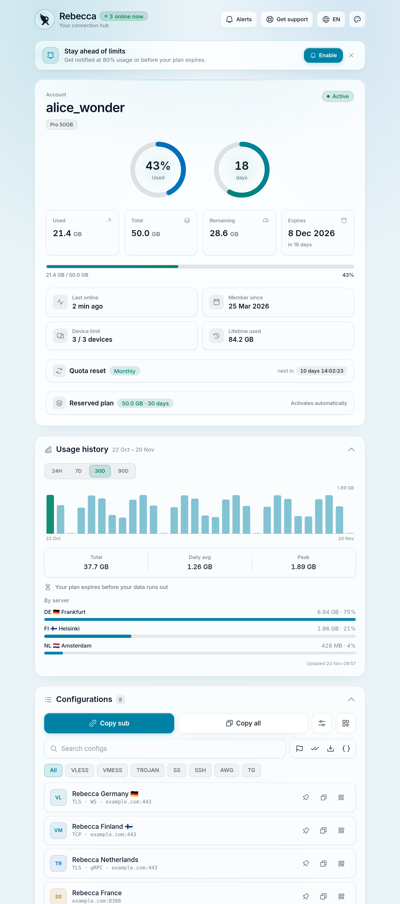
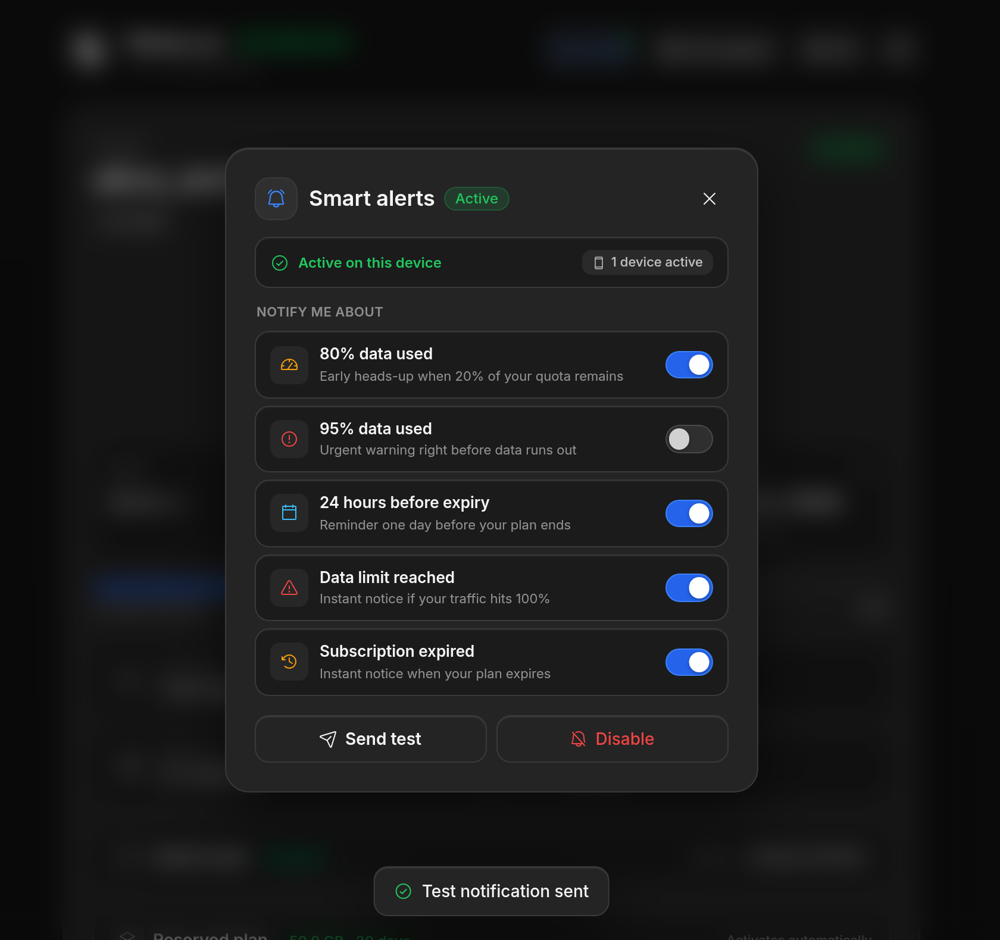
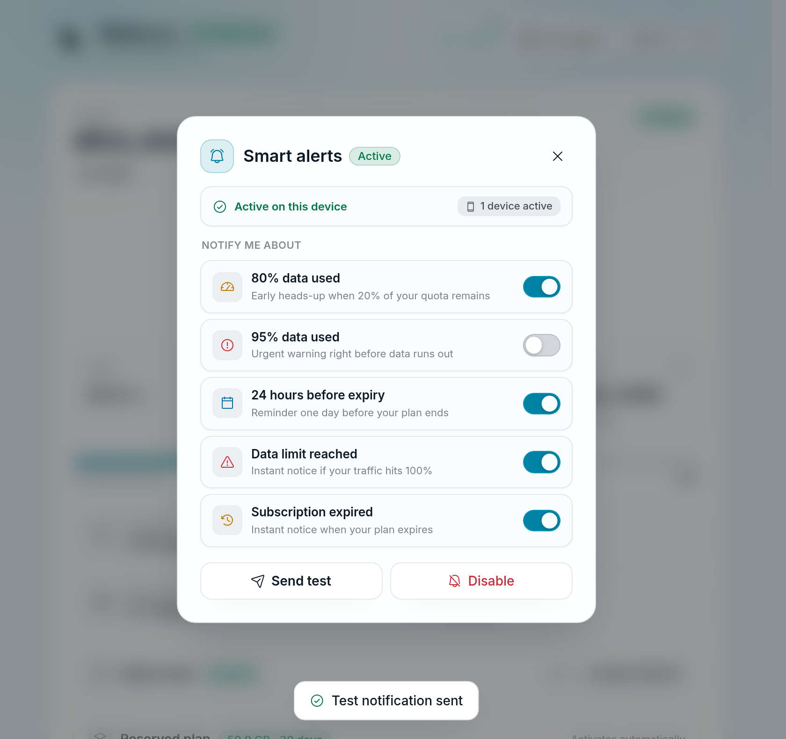

# 🕊️ Rebecca — Default Subscription Page Template

**Official Default Subscription Page Template (`rebecca-edition`) for the [Rebecca panel](https://github.com/rebeccapanel/Rebecca) (`dev` branch).**

Matte carbon UI · usage dashboard · EN/FA/RU/ZH + RTL · opt-in Web Push · Tailwind v4 + DaisyUI v5 + vanilla JS

> [!NOTE]
> This **`rebecca-edition`** branch is the source for Rebecca panel's bundled **Default Subscription Page Template** ([`templates/subscription/index.html`](https://github.com/rebeccapanel/Rebecca/blob/dev/templates/subscription/index.html) in `rebeccapanel/Rebecca`), built from **Aurora v4.3.1**.
>
> Looking for the standalone white-label **Aurora** edition (with `Aurora Dark` as default and the one-line installer)? Switch to the [`main`](https://github.com/Ho3einK84/Aurora/tree/main) branch.

---

## 📸 Preview

| Rebecca (Default) | Light |
| :---: | :---: |
|  |  |
|  |  |

*Rebecca Default Subscription Template (`rebecca` & `auroralight`) — authentic Rebecca panel matte carbon default surfaces, official monochrome winged-R emblem, opt-in Smart Web Push alerts with per-event controls, dual usage/time rings, responsive SVG bar chart with interactive glass tooltips, native mobile bottom sheets, and crisp LTR/RTL typography (`Inter` variable + `Dastkhat NoEn` variable).*

---

## ✨ Features

- **Rebecca Visual Identity First (`rebecca` Default Theme)** — 4 built-in themes in order: **`Rebecca`** (default — matte carbon `#111111`/`#242424` surfaces with `#3a3a3a` borders and Royal Blue `#2563eb` / emerald `#10b981` accents matching Rebecca `dev`), **`Light`** (`auroralight` — frosted alabaster glass), **`Midnight`** (`auroradark` — boreal cyan & deep navy glassmorphism), and **`AMOLED Dark`** (`amoleddark` — pure `#000000` OLED contrast).
- **Official Emblem & Panel Branding** — ships with Rebecca's official monochrome winged-R SVG emblem (`fill="currentColor"` for crisp dark & light contrast) and `"Rebecca"` fallback title; automatically adopts your panel's **Subscription profile title** (`subscription_profile_title`) when configured.
- **Live Service Card** — usage/time rings, animated stats, live quota-reset countdown, and 5-minute background `/info` sync. Handles unlimited, never-expire, `on_hold` (exact pre-activation duration & *"Starts on first connect"*), reserved/queued `next_plans` badge, device limit (`ip_limit`), lifetime traffic, client-derived expired/limited states, and smart low-traffic / low-time renewal alerts.
- **Smart Web Push Alerts (Opt-in & Dormant by Default)** — forward-compatible Web Push alert controls (`80%` / `95%` data usage, `24h` before expiry, data limit reached, and expired) with a top-bar bell button, dismissible prompt, 5 per-event toggles, test notification, multi-device counter, iOS 16.4+ Home Screen PWA guide, and subdirectory proxy support. Completely hidden with zero network overhead unless `web_push_public_key` is enabled by the panel.
- **Support & Renewal** — top-bar quick support button with warning border highlight (`alert-active`) when subscription expiration is near or traffic is running low (automatically suppressed if a reserved plan is already queued).
- **Usage Dashboard 2.0** — `24H` (hourly), `7D`, `30D`, and true `90D` history charts (`?start=`), period summary pill (Total, Daily Avg, Peak), threshold alerts, per-server breakdown, depletion forecast, offline cache, and 5-min auto-refresh.
- **Smart Configs 2.0** — search (remarks, protocols, transports, SNI, host), protocol filters (VMess, VLESS, Trojan, Shadowsocks, Hysteria2, TUIC, SSH, WireGuard, AmneziaWG, MTProto), pin/favorite configs, clean metadata summary subline (`Reality · TCP · server:port`), click-to-inspect **Connection Details Modal** with per-field copy, localized group-by-country (`Intl.DisplayNames`), bulk select + copy, `.txt`/`.json` export, direct `.conf` download for WireGuard and AmneziaWG (with full obfuscation params), and multi-format subscription popover (`Clash Meta`, `Sing-box`, `V2Ray JSON`, `OpenWrt PassWall`, `WireGuard`).
- **VPN & Remote Access Files** (OpenVPN · WireGuard · AmneziaWG · SSTP · GRE · L2TP/IPsec · PPTP · IKEv2 · Cisco AnyConnect) — download/copy `.ovpn` and `.conf` profiles, masked credential cards with MTU/TTL/DNS, one-click Linux (`ip tunnel`) & MikroTik RouterOS (`/interface gre`) CLI commands for GRE, and Windows `.pbk` (phonebook) generation for PPTP, L2TP, IKEv2, and SSTP.
- **Apps & Multi-Language** — OS-grouped client catalogue (`src/apps.json`), EN/FA/RU/ZH with full BiDi RTL support (`Inter` + `Dastkhat NoEn`), PWA-ready single self-contained HTML output, and zero external requests at runtime.

---

## 🚀 Building & Using as Rebecca's Default Template

### Build `templates/subscription/index.html` from Source

```bash
git clone -b rebecca-edition https://github.com/Ho3einK84/Aurora.git rebecca-template
cd rebecca-template
npm ci
npm run build      # → dist/index.html (single self-contained file)
npm run guard      # verify pongo2 directives & zero external loads
```

Copy the compiled single-file template into Rebecca's bundled templates directory or live server custom templates directory:

- **Rebecca source repo (`dev`):** `cp dist/index.html /path/to/Rebecca/templates/subscription/index.html`
- **Live Rebecca server:** `cp dist/index.html /var/lib/rebecca/templates/subscription/index.html`

> [!TIP]
> Pre-built `index.html` artifacts for every commit on `rebecca-edition` are also available in this repository's **Actions → Build & Release** runs. For standalone custom-branded installs and `install.sh`, see [`main`](https://github.com/Ho3einK84/Aurora/tree/main).

---

## 🎨 Customization

- **White-label, Default Theme & Language (No Rebuild Needed)**:
  Edit `window.AURORA_BRAND` JSON literal or `<meta>` tags in `dist/index.html`:
  ```html
  <meta name="aurora-brand" content="Rebecca" />
  <meta name="aurora-default-theme" content="rebecca" />
  <meta name="aurora-default-lang" content="en" />
  <meta name="aurora-server-breakdown" content="true" />
  <script>window.AURORA_BRAND = {"name":"Rebecca","defaultTheme":"rebecca"};</script>
  ```
- **Supported Themes (`data-theme`):** `rebecca` (default), `auroralight` (`Light`), `auroradark` (`Midnight`), `amoleddark` (`AMOLED Dark`).
- **Apps:** Edit `window.AURORA_APPS` in `dist/index.html` or `src/apps.json` before rebuilding.

---

## 🛠 Development

```bash
npm ci
npm run build      # → dist/index.html
npm run serve      # preview at http://localhost:8787
npm run guard      # re-verify directive guard
```

---

## 📄 License

MIT
